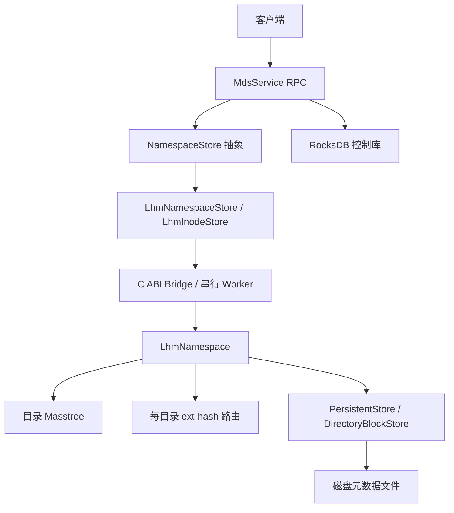

# LHM 元数据管理设计与代码导读

> 历史导读：本文件描述 v1 接入过程。2026-11-04 的编号、共享目录头、流式导入和重开实现以 [LHM v2 设计](lhm-v2-design.md) 为准；下文旧磁盘布局和 fresh-store 限制不可用于 v2。

本文供首次接触项目的同学阅读。目标是能解释“路径怎样找到 inode、inode 在磁盘哪里、批量创建怎样构造这些结构”，并能沿调用链阅读代码。外部调用参数和启动命令见 [元数据服务使用与接口说明](service-api.md)。

本文描述当前 ZB 专用实现。源码位于 `third_party/lhm`，原工作区 `MasstreeLHM-index` 不是这次 ZB 修改的目标。我们采用简化模型，不展开事务、恢复或并发冲突协议；文中提到其限制是为了准确说明当前能力。

## 1. 从一棵目录树开始

```text
/
├── project/
│   ├── a.txt
│   └── empty/
└── b.txt
```

先区分六个概念：

| 概念 | 在例子中的含义 |
|---|---|
| 路径 | `/project/a.txt`，由父子关系和名称组成 |
| 目录项 | `project` 中名为 `a.txt` 的孩子，以及它的类型和引用 |
| inode | 文件/目录对象的属性，如类型、权限、大小、时间、位置 |
| inode ID | 对象身份；改名后保留，用于绕过路径解析查询属性 |
| inode 块 | 磁盘上的一块固定长度元数据空间，容纳多个文件 inode |
| 文件句柄 | Open 后返回的服务端编号，当前与 inode ID 建立映射 |

`InodeAttr` 是 RPC 和 NamespaceStore 使用的 protobuf 属性对象，不是磁盘块。`inode_disk` 是 LHM 的磁盘 inode 格式。适配层负责两者转换，不能把 protobuf 对象的内存直接写入磁盘。

路径 `/project/a.txt` 改成 `/project/report.txt` 后，名称和目录索引发生变化，inode ID 保持不变。因此“入口通常是路径”和“后续可以按 inode ID 操作”并不矛盾。归档回报、属性更新等操作已经持有 ID，没必要重新构造路径。

## 2. 整体分层与职责



- **MDS 服务层**：协议检查、数据放置、句柄、位置视图、归档业务。
- **NamespaceStore**：命名空间语义接口，使服务不依赖 RocksDB key 或 LHM 类型。
- **LhmNamespaceStore/LhmInodeStore**：适配 protobuf 属性、状态码、生命周期及创建对象。
- **Bridge**：使用普通 C 数据结构隔离新旧 Masstree 符号和 C++ 类型；原生调用在一个模块工作线程上串行执行。
- **LhmNamespace**：协调目录路由、文件名索引和 inode 存储。
- **PersistentStore**：固定块 I/O、inode 分配与缓存。
- **DirectoryBlockStore**：目录头块、文件名桶、ext-hash 路由和目录块缓存。

串行 Worker 给原生操作提供固定线程环境和 RCU 生命周期；它不等于事务，也不保证一次跨多批 RPC 业务操作完全隔离。当前也未宣称已优化多核并发吞吐。

### 2.1 LHM 替代了什么，RocksDB 还做什么

LHM 模式下，原热命名空间和冷命名空间统一通过 LHM 查询，不再用旧冷热路由选择另一棵命名空间。路径关系和 inode 属性由 LHM 保存；旧模板可以作为导入源，但不是导入后查询的后端。

RocksDB 仍是 MDS 的控制存储，包含句柄关系、完整数据位置记录、节点名录/快照、路径放置策略，以及部分旧流程的任务和租约记录等。是否实际使用某项取决于业务模式：旧任务归档接口存在，不表示它已接入当前简化 LHM 归档流程。

| 数据类别 | 当前职责 |
|---|---|
| 文件/目录属性、路径关系 | LHM 命名空间 |
| 文件名到 inode 地址 | LHM 每目录文件桶与内存路由 |
| `H/` 句柄记录 | RocksDB 控制库 |
| `DL/OL` 完整位置记录 | 控制库；位置解析器可结合 inode 紧凑字段 |
| 节点目录/名录快照 | 描述存储节点身份、地址等，不是文件目录树快照 |
| 路径放置策略 | 指定路径前缀的数据放置偏好，不是路径索引 |
| 旧归档任务、租约 | 旧业务控制协议，不是当前简化归档所需机制 |

因此“GetInode 不必查询 RocksDB”和“Open 可能访问 RocksDB”可以同时成立：前者只读取 LHM 属性，后者还涉及位置和句柄。

## 3. 磁盘布局：ID 为什么能定位 inode

### 3.1 固定块格式

元数据块为 16 KiB，即 16384 字节；inode 为 256 字节。

```text
文件 inode 块（16384 B）
┌───────────────────────────────────────────┐
│ 公共头 64 B                               │
├───────────────────────────────────────────┤
│ inode 块头 192 B：槽数、使用数、位图等      │
├───────────────────────────────────────────┤
│ inode[0] 256 B ... inode[62] 256 B          │
└───────────────────────────────────────────┘
64 + 192 + 63 × 256 = 16384

目录块（16384 B）
┌───────────────────────────────────────────┐
│ 公共头 64 B                               │
├───────────────────────────────────────────┤
│ 目录块头 64 B                             │
├───────────────────────────────────────────┤
│ 嵌入目录 inode 区域 256 B                 │
├───────────────────────────────────────────┤
│ payload 16000 B                           │
└───────────────────────────────────────────┘
```

目录头块保存目录自身 inode 和名称。文件名索引桶也使用目录块格式，其 payload 保存文件目录项和偏移索引，不应把每个桶都理解成另一个真实目录。

文件目录项包含名称哈希、实际名称、inode 块号和槽位。桶内保留名称用于精确匹配；哈希只负责定位候选位置。payload 的记录区和索引区共同占用空间，判断是否能放入一个名字不能只按文件数量计算。

结构定义见 [metadata_layout.hh](../../third_party/lhm/metadata_layout.hh)，块镜像见 [persistent_store.hh](../../third_party/lhm/persistent_store.hh)。

### 3.2 文件与目录 ID

文件 inode ID 的编码为：

```text
id = (uint64(block_id) << 32) | slot
block_id = id >> 32
slot = id 的低 32 位，合法槽位为 0..62
```

普通目录 ID 使用最高位标记：

```text
id = (1ULL << 63) | directory_head_block_id
```

root 对外固定为 1，桥接层映射到其原生根 inode。root 的初始化保留了一个文件 inode 槽，并且目录头块有嵌入 inode，不能按普通文件或普通目录的外部 ID 规则直接解码 root。

**不需要一张全量 `inode_id -> inode 地址` 内存索引表。** ID 本身编码地址。但它也不是简单的“第 N 个文件对应数组第 N 项”：文件和目录编码不同，root 特殊，预留、取消和删除也影响分配。调用者应把它当作不透明标识。

### 3.3 逻辑块号与文件偏移

inode 块与目录块分别分配逻辑编号，共用一个文件，使用交错映射：

```text
inode 逻辑块 b    → 物理块 2b - 1
目录逻辑块 d     → 物理块 2d
物理块 p 的偏移  → p × 16384 字节
```

物理块 0 保留给存储元信息。普通文件 inode 的字节位置为：

```text
(2b - 1) × 16384 + 64 + 192 + slot × 256
```

例如文件 ID 编码 `b=2, slot=3`，所在物理块为 3；inode 起始偏移是：

```text
3 × 16384 + 256 + 3 × 256 = 50176
```

这是定位计算示例，不表示任何运行都会把 a.txt 分到该位置。实际 I/O 按块进行，缓存未命中时读取整块，不是发起一次 256 字节的随机读取。

已知 ID 后，读取还要检查分配范围、类型、ID 一致性、删除/预留标志和 link_count。能够计算地址不等于该对象存在。

## 4. 内存里保存哪些索引

### 4.1 目录 Masstree：找到目标目录

目录路径按分量解析，每个分量产生哈希。目录 Masstree 通过层间引用连接父子目录，保存目录块引用及文件索引 ID 等目录元信息。

查询 `/project/a.txt` 时，先找到 `/project` 对应目录层。文件 a.txt 不作为一条全路径 key 放进目录 Masstree。当前结构也不是一张保存所有文件 inode 的全内存表。

目录键使用分量哈希；不能因此宣称支持任意哈希碰撞的独立目录身份。文件桶保留实际名称以核对，而目录层的键语义应按现有代码理解。

Masstree 分裂后旧根节点可能已不是实际根。当前 root() 沿父关系取得真实根，保证直接扫描宽目录不会从旧左叶开始漏掉其他条目。这也是批量导入测试修复的问题之一。

### 4.2 每目录 ext-hash：从文件名找到 inode 地址

每个目录有文件索引状态：空、单桶、多桶。

- 桶内容在磁盘，含实际文件名和 inode_ref。
- 内存保存 global_depth、槽表、桶描述符等路由信息。
- 名称哈希的低 global_depth 位选择槽，槽映射到桶。
- 多个槽可以引用同一桶；桶的 local_depth 决定其分区粒度。
- 桶满后拆分，必要时扩展槽表；最大深度目前为 20。

```text
文件名 → hash → 低位槽号 → 桶描述符 → 磁盘桶
                                         ↓
                                  匹配实际名称
                                         ↓
                                   inode_ref
```

目录头块与文件名桶分开，是为了让一个目录可以拥有多个文件名桶，而目录自身 inode 的位置保持稳定。

### 4.3 缓存和 I/O

inode L0 缓冲、inode 块缓存和目录块缓存服务于不同访问路径。它们命中时可减少磁盘读取；未命中会通过 PersistentStore 读取对应块。当前存储文件使用 direct I/O，不应把缓存命中时的速度当成必然的磁盘读取成本。

一个逻辑块地址可直接计算，不代表完全没有索引访问或永远只进行一次 I/O：路径查询需要目录定位和文件名桶；只有已经持有 inode ID 才能绕过这部分。

内存分析还应区分永久索引、缓存和操作暂态空间。若做性能实验，遵守工作区的总内存统计规则，不能只报 RSS 或仅计算哈希槽表。

## 5. 一次普通操作如何完成

### 5.1 路径查询

```text
Lookup('/project/a.txt')
 → MdsServiceImpl::ResolvePath
 → NamespaceStore::ResolvePath
 → LhmNamespaceStore → checked Bridge
 → 定位 /project 目录层
 → 在该目录文件哈希桶内找到 a.txt 的 inode_ref
 → 读取 inode 块，取得指定槽
 → 解码完整属性，返回 InodeAttr
```

文件位置查询在此基础上还会解析完整位置记录、紧凑节点 ID、节点地址等，不能与纯 inode 查询的开销混为一谈。

### 5.2 已知 inode ID 查询

```text
Getattr(id) → GetInode(id)
 → 区分 root / 普通目录 / 文件
 → 解码块号、槽位并校验
 → 读缓存或磁盘块
 → 解码属性
```

这条路径不需要重新走文件路径，也不需要向 RocksDB 查询 inode。文件删除后即便原 ID 还能算出相同地址，存在性检查也会拒绝读取为有效对象。

### 5.3 创建文件

1. 服务验证路径、父目录和目标存在性。
2. ReserveCreate 按类型预留文件槽或目录头块，得到最终 ID，但尚未发布路径。
3. MDS 填充属性；普通 Create 还执行放置选择，准备数据位置。
4. Commit 写 inode，并把目录项接入父目录索引；目录创建还接入目录层。
5. 失败或提前退出时预留对象可取消，析构也会取消未完成预留。

预留状态避免“属性还没准备好，路径已经可见”。它不是事务：提交途中 I/O 失败不保证所有动作回滚。仅取消的未发布空间可按现有池机制复用，不能据此认为已删除的公开 ID 会立即重新分配。

### 5.4 属性更新、改名和删除

PutInode 更新属性，保留后端的地址、结构引用等内部信息。完整属性通过 [LhmAttributeCodec.h](../../src/mds/lhm/LhmAttributeCodec.h) 编码：基础字段使用 native inode 核心区，ZB 扩展使用 reserved 中的版本化小端编码。当前扩展占用 164 字节保留区中的 161 字节，名称上限因此为 64 字节。

文件改名更新父目录文件名索引；跨目录移动还更新所属关系。目录改名/移动调整目录路由与名称，使已有子树继续可达。ID 保持不变，不能将改名理解成删除整个子树再重新分配全部 inode。具体路径会因条件进入不同原生分支，本文不承诺所有目录改名均为常数时间。

删除区分文件和目录，目录必须为空，根不能删除。索引解除与 inode 删除状态共同决定对象是否可见。当前没有完整 POSIX 打开后 unlink 生命周期保证。

### 5.5 句柄的真实结构

当前 Open 不是把整个 inode 放进一个新的内存句柄对象，而是：

```text
path → inode_id → 构建位置视图
                    ↓
             分配 handle_id
                    ↓
        控制库 H/<handle_id> = 编码 inode_id
```

返回值是 handle_id 和 FileLocationView。Close 删除 H 记录。现有 Getattr、UpdateInodeStat、GetFileLocation 接收 inode ID，并非接收句柄后自动解引用。因此“打开之后拿 ID 直接查 inode”指 LHM 地址解码能力，不意味着所有句柄操作已经绕开控制库。

## 6. 两种遍历为什么分开实现

### 6.1 Readdir：方便外部调用的名称分页

返回当前目录的直接孩子，按名称字节序排列，以 start_after 排他续页。当前实现每页先收集并排序整个目录，因此单页时间约 O(n log n)，暂态内存 O(n)。limit 限制输出数量，不等于底层只读取 limit 个条目。

### 6.2 子树扫描：面向批处理的增量推进

`BeginSubtreeScan` 返回内存游标，`Next(max_entries)` 分批产生完整属性。游标使用 DFS 栈，保存逻辑目录引用、最后访问的孩子哈希，以及当前文件桶进度，不把 Masstree 节点裸指针跨工作线程任务保留下来。

每层先扫描自己的文件桶，再寻找下一子目录并下潜。文件桶按唯一桶描述符遍历，不按可能存在别名的 ext-hash 槽表遍历，因此同一桶不会因多个槽引用而重复输出。下潜前释放文件缓冲，主要游标内存为一个桶加 O(目录深度) 栈。

work_budget 限制一次 Next 的推进步骤，加载桶或处理空目录也消耗步骤，因此可能出现“没有条目，但还没结束”。root 本身不返回；files_only 控制是否输出目录属性；不保证名称顺序，也不返回完整路径。

扫描没有快照：结构保持不变是调用方前提，属性读取是实时的。错误时当前批次丢弃，先前已返回批次保留；这不是跨批回滚。

## 7. 批量构建：先磁盘结构，后运行时索引

### 7.1 为什么不循环调用 Create

普通创建适合逐个请求，但每条都要解析父路径、分配空间、更新 inode、修改文件桶，桶满还要不断分裂。已知完整清单时，可以提前安排文件槽和桶分区，减少重复操作。

本实现不是把 Create 放进 for 循环，而是有独立的构建路径：

```text
清单校验 → 临时父子表 → 目录头块分配
 → 按父目录排列文件 → 完整 inode 块提交
 → 文件名预分桶 → 完整桶提交 → flush/sync
 → 安装 ext-hash 路由 → 建立目录 Masstree → 发布 context
```

### 7.2 临时编号是什么

读取清单后每条记录在数组中有下标，parent 保存父记录的下标。例如 project 的下标是 1，a.txt 的 parent=1。这些数只用于构建依赖关系，既不是用户指定的 inode ID，也不是额外永久索引。

先分配所有目录头块，就能获得最终父目录 ID，再填写文件 inode。临时下标完成使命后随构建计划释放。

### 7.3 文件 inode 的排列

文件按父目录分组，组内保持输入顺序；父目录组按首次出现顺序处理。批量分配从 ticket=1 开始，ticket=0 保留根：

```text
block_id = ticket / 63 + 1
slot = ticket % 63
```

所以第一 inode 块除 root 外可以继续放 62 个文件，第 63 个文件进入下一块。文件只占一个连续槽位，不为每个文件建立新的磁盘文件。

`WriteFreshFileInodes` 对每块组装完整镜像后提交，并更新分配游标。需要先处理 L0 中的旧块，再失效 root 初始化时的 TLS 预留区；否则后续普通创建可能覆盖新数据或读取旧缓存。连续销毁和新建存储时也必须清除当前线程指向旧实例的 TLS 指针。

### 7.4 文件名预分桶与安装索引

先按目录收集文件名项，在内存中用实际编码长度尝试装桶。溢出时按下一哈希位划分两个分区，直到每个分区可装下。最终桶提交磁盘后，记录 local_depth、global_depth 和槽到桶的映射。

空兄弟桶也保留，使后续普通插入能沿标准 ext-hash 规则运行。所有磁盘写入同步后才安装运行时索引；创建目录层时重新定位父层，因为插入可能触发 Masstree 根分裂。

“按块提交”不等于整个构建只有一次顺序 write。root 和目录块分配仍可能产生空块初始化写入，缓存也可能合并或冲刷写入；inode 和目录物理块交错。统计 inode_blocks/buckets 表示结构数量，不是 I/O 次数或真实磁盘占用。

### 7.5 导入完成后为什么仍能增删改

批量与普通操作使用相同 inode 格式、ID 编码、目录桶格式和 ext-hash 元信息，且普通分配器从新游标继续。批量路径只改变初始化方法，不另建一套只读格式。

当前仍把清单、父子关系、inode 和桶计划放入内存；尚无外部排序或限内存流式装载。生成的磁盘文件也不能在进程退出后直接恢复内存索引，这与“构建完当前进程可以使用”是两件事。

## 8. 归档怎样作用于命名空间

当前简化流程如下：

```text
目录扫描或 inode ID 列表
 → 构造带来源位置的文件清单
 → 发给光盘节点
 → 光盘节点申请镜像 ID 并封装
 → ReportFilesPackedToImage：回写 image ID / IMAGE_READY
 → 光盘节点申请光盘 ID 并完成刻录
 → ReportImagesBurnedToDisc：回写 disk ID / ARCHIVED
```

MDS 分配 ID，光盘节点负责按容量封装。inode 保存镜像/光盘属性；没有 image_id → inode_ids 反向索引，因此刻录上报需要分批扫描根命名空间，查找匹配镜像的文件。代价随命名空间文件总数增长，这是当前明确选择的简单实现。

元数据受理、镜像就绪、刻录完成是三个不同时间点。归档状态更新不会自动删除热副本，也不等于客户端光盘读路由已经切换。节点名录、位置记录和归档副本属性属于相关但不同的职责。

旧归档任务状态与租约是另一套控制机制，不能拿其接口存在来推断本流程有恢复或互斥能力。这里采用单 MDS、单任务、文件结构不变的模型。

## 9. 代码阅读顺序与练习

| 顺序 | 文件 | 阅读目标 |
|---|---|---|
| 1 | [NamespaceStore.h](../../src/mds/storage/NamespaceStore.h) | 先看接口契约，理解创建对象和扫描对象 |
| 2 | [LhmNamespaceStore.cpp](../../src/mds/lhm/LhmNamespaceStore.cpp) | 看路径/ID/分页如何适配 |
| 3 | [LhmBridge.cpp](../../src/mds/lhm/LhmBridge.cpp) | 理解 C ABI、Worker、root ID 转换 |
| 4 | [LhmAttributeCodec.h](../../src/mds/lhm/LhmAttributeCodec.h) | 区分 RPC 属性和磁盘 inode |
| 5 | [lhm_namespace.hh](../../third_party/lhm/lhm_namespace.hh) | 串起 lookup、reserve/commit、scan 等操作 |
| 6 | [masstree_directory_index.hh](../../third_party/lhm/masstree_directory_index.hh) | 理解目录层关系 |
| 7 | [directory_block_store.hh](../../third_party/lhm/directory_block_store.hh) | 理解文件桶、路由、缓存和扫描 |
| 8 | [persistent_store.cc](../../third_party/lhm/persistent_store.cc) | 理解块地址、分配游标、I/O 和 L0 |
| 9 | [LhmBulkBridge.inc](../../src/mds/lhm/LhmBulkBridge.inc) | 清单检查、输出文件保护、工厂入口 |
| 10 | [namespace_bulk_build.inc](../../third_party/lhm/namespace_bulk_build.inc)、[directory_bulk_build.inc](../../third_party/lhm/directory_bulk_build.inc) | 批量组装和延迟发布 |
| 11 | [MdsServiceImpl.cpp](../../src/mds/service/MdsServiceImpl.cpp) | 回到 RPC，区分命名空间和业务控制 |

建议按问题阅读，而不是先通读整个仓库：

1. 用 Lookup 得到文件 ID，解码它并根据公式计算 inode 所在位置；再用 Getattr 验证属性相同。
2. 改名后比较 ID，观察 file_name 与路径如何变化。
3. 比较 Readdir 的 Dentry 与子树扫描的 InodeAttr；理解为何后者没有完整路径。
4. 读批量测试的 62/63 文件边界，解释为什么会跨块。
5. 导入后普通创建超过一个分配区间，检查旧 ID 不被覆盖。
6. 关闭 L0 和目录块缓存运行同一功能测试，区分语义正确性与缓存收益。

优先运行 [lhm_bulk_import_test.cpp](../../tests/mds/lhm_bulk_import_test.cpp)，再看 [lhm_namespace_test.cpp](../../tests/mds/lhm_namespace_test.cpp) 和 [subtree_scan_test.cpp](../../tests/mds/subtree_scan_test.cpp)。RPC 示例由 [lhm_bulk_startup_test.py](../../tests/mds/lhm_bulk_startup_test.py) 覆盖。测试是可复现检查，不是大规模性能结论；运行数据应遵守工作区存储和固定实验数据集规则。

## 10. 当前设计的边界

- 当前 runtime 索引驻留内存，启动导入构建计划也占内存；不能声称所有元数据内存开销为常数。
- ID 编码免去全量 ID 索引，不会免去所有目录索引、缓存、范围检查或磁盘读取。
- Readdir 分页不等于流式底层扫描，子树扫描提供的是另一种能力。
- 按块写入不等于恢复能力；fresh-store、事务和重启恢复的边界必须分别理解。
- LHM 替代命名空间不等于删除整个 RocksDB 控制库。
- 单工作线程的串行操作不等于跨 RPC 事务或归档任务隔离。

继续优化时应先确定要解决的实际瓶颈，例如导入内存峰值、桶构建 CPU 成本或目录分页成本，再设计测量。本文不将这些方向写成已经实现的能力。
