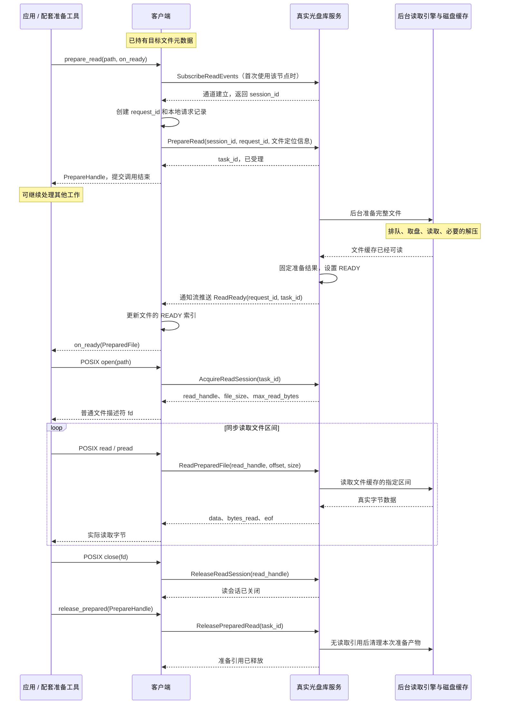

# 客户端与真实光盘库节点的读取接口设计

本文依据[客户端与真实光盘库节点的文件读取设计](client-optical-read-notification-design.zh-CN.md)，单独约定双方需要实现的接口、参数、行为和调用顺序。第 2 节是双方共同遵守的协议，第 3 节面向客户端实现，第 4 节面向光盘库实现，第 7 节用于双方联调验收。

## 1. 适用范围与已有输入

客户端负责人为武家浩，真实光盘库节点负责人为马崇文。设计起点是客户端已经通过原有流程取得光盘文件的元数据；本方案不增加客户端与 MDS 的交互。

对应用采用“异步文件准备接口＋标准 POSIX 读取接口”：先提交准备，光盘库完整准备文件后主动通知客户端，应用再通过原挂载路径执行 open/read/pread/close，最后显式释放准备结果。

只考虑文件存在、内容和位置稳定、缓存充足、两端正常运行且网络正常的场景。不涉及光盘写入、归档、仿真节点、其他模块协作，也不设计断线、重试、重复通知、崩溃恢复或超时回收。

客户端内部已有的文件上下文为 OpticalFileInfo，包含以下信息：

| 信息                 | 用途                                 |
| -------------------- | ------------------------------------ |
| node_address         | 选择真实光盘库数据服务地址           |
| inode_id             | 文件身份                             |
| disk_id              | 文件所在光盘标识                     |
| image_id             | 文件所在镜像标识                     |
| file_size            | 文件逻辑大小                         |
| file_version（可选） | 原有元数据提供时携带，不为此新增查询 |

路径和文件上下文保留在客户端，用于关联准备结果和后续 POSIX 打开。光盘库自行定位和生成缓存，不向应用暴露服务端缓存路径。

## 2. 客户端与光盘库接口

本节作为武家浩（客户端）与马崇文（真实光盘库）的接口对接约定。以下接口均为**待实现设计**，不是当前代码已提供的完整能力；字段类型按下表约定，最终 Proto 字段编号由双方落实。

整体由 **6 个客户端发起的 RPC，以及 1 种光盘库主动发送的 Stream 消息**组成。RPC 放在现有 `OpticalNodeService` 中；客户端实现调用封装和通知接收器，不需要再开放供光盘库反向调用的 RPC 服务。

| 接口 / 消息           | 方向                          | 主要输入                                                     | 输出或作用                                             |
| --------------------- | ----------------------------- | ------------------------------------------------------------ | ------------------------------------------------------ |
| `SubscribeReadEvents` | 客户端 → 光盘库               | client_id，附带 Stream 建立                                  | session_id，建立后立即返回                             |
| `PrepareRead`         | 客户端 → 光盘库               | session_id、request_id、inode_id、disk_id、image_id、file_size，已有时附带 file_version | request_id、task_id、已受理；任务入队后立即返回        |
| `ReadReady`           | 光盘库 → 客户端的 Stream 消息 | request_id、task_id、inode_id、file_size，已有时附带 file_version | 告知完整文件已经进入可读缓存                           |
| `AcquireReadSession`  | 客户端 → 光盘库               | task_id                                                      | read_handle、file_size、max_read_bytes，并增加读取引用 |
| `ReadPreparedFile`    | 客户端 → 光盘库               | read_handle、offset、size                                    | data、bytes_read、eof                                  |
| `ReleaseReadSession`  | 客户端 → 光盘库               | read_handle                                                  | 关闭本次读会话，减少读取引用                           |
| `ReleasePreparedRead` | 客户端 → 光盘库               | task_id                                                      | 释放本轮准备引用，不再允许为该任务创建新会话           |

### 2.1 公共参数约定

| 字段或类型                                       | 约定                                                         |
| ------------------------------------------------ | ------------------------------------------------------------ |
| `status: OpticalStatus`                          | 光盘读取 RPC 的统一返回字段，采用独立定义的光盘状态类型；成功为 `status.code = OPTICAL_OK`。PrepareRead 成功只表示受理，不能当作 READY |
| `client_id: string`                              | FUSE 客户端实例标识，由客户端生成；SDK 和命令通过同一 FUSE 实例访问时共享它 |
| `request_id: string`                             | 客户端生成的准备请求标识，在该客户端实例内唯一；发送 PrepareRead 前已建立对应本地记录 |
| `session_id: uint64`                             | 光盘库分配的通知会话标识，与一个客户端通知 Stream 绑定       |
| `task_id: uint64`                                | 光盘库分配的准备任务标识，生命周期涵盖后台准备、就绪、读取和最终释放 |
| `read_handle: uint64`                            | 光盘库为一次独立打开分配的读取会话标识                       |
| `inode_id: uint64`                               | 已有元数据中的文件标识                                       |
| `disk_id / image_id: string`                     | 沿用现有元数据和光盘服务的标识格式，不要求客户端解析内部编号 |
| `file_size / offset / size / bytes_read: uint64` | 单位统一为字节；offset 为目标文件内绝对偏移                  |
| `file_version: uint64，可选`                     | 仅在已有元数据提供时携带；需保留“未提供”的含义，不以缺省值擅自推断版本 |
| `node_address`                                   | 用于客户端选择 RPC Channel 和通知连接，保存在本地文件上下文中，不必在每个请求内重复传递 |

session_id、task_id、read_handle 只在分配它们的光盘库节点内有效。客户端保存这些编号时必须同时保存节点地址。不同类型的编号不能互换；服务端本地缓存路径不出现在协议中。

本节表格中的请求字段均为功能上必填，只有 file_version 为可选。成功响应中列出的业务字段均应填充。本文只定义正常调用路径，不扩展异常恢复协议；服务端不能把未完成准备的任务作为成功读取返回。

光盘读取接口独立定义状态类型，建议在 `optical_node.proto` 中增加以下定义：

```protobuf
enum OpticalStatusCode {
  OPTICAL_OK = 0;
  OPTICAL_INVALID_ARGUMENT = 1;
  OPTICAL_NOT_FOUND = 2;
  OPTICAL_NOT_READY = 3;
  OPTICAL_INTERNAL_ERROR = 4;
}

message OpticalStatus {
  OpticalStatusCode code = 1;
  string message = 2;
}
```

| 状态码                     | 含义                                                         |
| -------------------------- | ------------------------------------------------------------ |
| `OPTICAL_OK`               | 本次 RPC 成功；具体完成了什么由接口语义确定                  |
| `OPTICAL_INVALID_ARGUMENT` | 参数不符合接口约定，例如单次读取 size 超过 max_read_bytes    |
| `OPTICAL_NOT_FOUND`        | 请求引用的文件、通知会话、准备任务或读取会话不存在           |
| `OPTICAL_NOT_READY`        | 文件准备尚未完成，不能建立读取会话；它不是要求客户端轮询的信号 |
| `OPTICAL_INTERNAL_ERROR`   | 光盘库内部处理失败；本阶段不展开异常恢复流程                 |

6 个 RPC 的响应均使用 `OpticalStatus status`。成功时 message 可为空；非成功时 message 用于描述原因，程序根据 code 判断结果，不解析 message。非成功响应中的业务字段不作为有效结果使用。

`OpticalStatus` 表示 **RPC 的执行结果**，不代替准备任务状态：PrepareRead 返回 OPTICAL_OK 只表示受理；完整文件就绪通过 ReadReady 通知；ReadPreparedFile 正常读到 EOF 仍返回 OPTICAL_OK，由 eof 标识末尾。ReadReady 本身是成功就绪事件，不需要携带 status。

该类型供本方案的光盘读取接口使用，不复用 MDS 状态类型，也不要求修改现有 MDS 或归档接口。现有 `optical_node.proto` 可能仍因其他接口保留对 `mds.proto` 的引用，但新读取接口的状态定义不依赖它。

### 2.2 SubscribeReadEvents：建立准备完成通知通道

**提供方：光盘库；调用方：客户端通知管理器。** 一个客户端首次访问一个光盘库时调用一次，后续多个文件复用该通道。

请求：

| 参数                 | 类型            | 含义                                                    |
| -------------------- | --------------- | ------------------------------------------------------- |
| `client_id`          | string          | 标识本次建立通知连接的 FUSE 客户端实例                  |
| 随 RPC 建立的 Stream | brpc 传输层对象 | 客户端预先创建并绑定接收处理器；不是 Proto 中的普通字段 |

响应：

| 参数         | 类型          | 含义                                  |
| ------------ | ------------- | ------------------------------------- |
| `status`     | OpticalStatus | 通知会话建立结果                      |
| `session_id` | uint64        | 后续 PrepareRead 用它指定通知接收通道 |

双方需要实现的动作：

1. 客户端用 `StreamCreate` 创建 Stream，注册通知接收处理器，通过同一个 Controller 发起订阅 RPC，协议使用 `baidu_std`。
2. 光盘库用 `StreamAccept` 接受 Stream，生成 session_id，保存 `session_id → client_id、服务端本地 StreamId`，然后返回。
3. 客户端保存 `node_address → session_id、客户端本地 StreamId`；订阅成功后才向该节点提交 PrepareRead。

**session_id 是业务会话编号，不是 brpc StreamId。** 两端的 StreamId 分别由各自进程使用，不能当成跨端通用编号传递。订阅 RPC 在连接建立后结束，Stream 持续存在以便服务端主动通知，不占用一个等待数小时的订阅 RPC。

该接口不准备文件、不读取文件，也不返回文件内容。一次订阅可接收多个文件的 ReadReady；正常退出时客户端关闭 Stream，无需另增 Unsubscribe RPC。

### 2.3 PrepareRead：提交整文件异步准备任务

**提供方：光盘库；调用方：客户端准备管理器。** 客户端收到应用的 prepare_read 后调用，光盘库登记任务并入队后立即返回。

请求：

| 参数           | 类型         | 含义                                                      |
| -------------- | ------------ | --------------------------------------------------------- |
| `session_id`   | uint64       | 已建立的通知会话，决定完成后向哪个 Stream 发送事件        |
| `request_id`   | string       | 客户端准备请求编号，用于关联 RPC 响应、完成通知和本地回调 |
| `inode_id`     | uint64       | 要准备的文件身份                                          |
| `disk_id`      | string       | 文件所在光盘标识                                          |
| `image_id`     | string       | 文件所在镜像标识                                          |
| `file_size`    | uint64       | 已有元数据给出的逻辑文件大小，用于核对准备结果            |
| `file_version` | uint64，可选 | 已有元数据中的版本；未提供时不要求增加版本查询            |

响应：

| 参数         | 类型          | 含义                                        |
| ------------ | ------------- | ------------------------------------------- |
| `status`     | OpticalStatus | OPTICAL_OK 表示任务已登记并入队，不表示可读 |
| `request_id` | string        | 原样返回，关联客户端已有记录                |
| `task_id`    | uint64        | 光盘库创建的准备任务编号                    |

“已受理”由成功 status 表达，不再单独添加含义重复的 accepted 字段。服务端在后台任务可执行前，必须保存 task_id、request_id、session_id 和文件定位信息的对应关系。随后后台执行排队、取盘、镜像读取和必要的解压。

客户端在发送 RPC 前建立本地请求记录；收到成功响应后记录 task_id，并向应用返回 PrepareHandle。此时应用可以继续做其他工作。若 ReadReady 已先被接收线程处理，受理响应只补充记录，不把状态从 READY 改回“已提交”。

本接口按**整个文件**准备，不接收 offset/size，也不接收文件内容或客户端指定的服务端缓存路径。一个客户端可同时准备多个不同文件，各任务独立通知；同一文件的重复准备按第 3.4 节约定避免。

### 2.4 ReadReady：完整文件准备完成事件

**发送方：光盘库后台完成处理器；接收方：客户端 Stream 接收器。** 这是序列化后写入通知 Stream 的消息，不是新增的 RPC 方法。

消息字段：

| 参数           | 类型         | 含义                                                         |
| -------------- | ------------ | ------------------------------------------------------------ |
| `request_id`   | string       | 找到客户端在提交前登记的准备请求                             |
| `task_id`      | uint64       | 后续 AcquireReadSession 和 ReleasePreparedRead 使用的任务编号 |
| `inode_id`     | uint64       | 核对通知对应的文件身份                                       |
| `file_size`    | uint64       | 完整准备产物的实际逻辑大小；在本文假设下与提交值一致         |
| `file_version` | uint64，可选 | 提交时携带则原样关联；未提供则不添加虚构版本                 |

接收通道已经确定节点和通知会话，事件无需重复携带 session_id。ReadReady 这一消息类型本身表示成功就绪，不再添加进度字段或完成状态查询。

光盘库发送事件之前，必须依次完成：

1. 生成完整可读文件产物，包括需要的解压或文件提取。
2. 建立准备引用，保证通知之后产物持续存在。
3. 将任务发布为 READY，使随后的 AcquireReadSession 可以立即成功。
4. 按任务绑定的 session_id 找到 Stream，写入一条序列化的 ReadReady 消息。

只完成装载盘片或缓存镜像不能发送 ReadReady。通知不携带文件内容，真正数据通过 ReadPreparedFile 获取。

客户端接收器解析每条 Stream 消息，利用通知连接和 request_id 找到本地任务，保存 task_id 和大小，**先更新“文件身份 → READY 任务”的索引，再通过本地控制通道通知 SDK/工具**。SDK 随后调度 on_ready 回调。这样应用收到回调就可以立即 open 原路径。

客户端需要实现的 `HandleReadReady(event)` 是进程内处理入口，由 Stream 接收处理器调用，不对网络开放。回调不在 Stream 接收线程中执行长时间业务读取。

### 2.5 AcquireReadSession：为一次打开建立读取会话

**提供方：光盘库；调用方：客户端 FUSE 打开路径。** 在文件已经 READY、准备引用仍存在时调用。

请求：

| 参数      | 类型   | 含义                          |
| --------- | ------ | ----------------------------- |
| `task_id` | uint64 | 当前文件对应的 READY 准备任务 |

响应：

| 参数             | 类型          | 含义                                                         |
| ---------------- | ------------- | ------------------------------------------------------------ |
| `status`         | OpticalStatus | 建立读取会话的结果                                           |
| `read_handle`    | uint64        | 本次独立打开专属的读取会话                                   |
| `file_size`      | uint64        | 当前准备文件的完整大小                                       |
| `max_read_bytes` | uint32        | 本会话允许的单次 ReadPreparedFile 最大请求字节数，必须大于 0，在会话期间固定 |

光盘库增加该任务的读取引用，保存 `read_handle → task_id、缓存文件、文件大小`，然后返回。客户端把节点地址、read_handle、file_size、max_read_bytes 绑定到本次 FUSE 文件句柄，随后完成应用的 open。

同一准备任务可多次调用 AcquireReadSession，每次返回独立 read_handle。两个程序分别打开同一文件时，不需要再次取盘，但各自持有读取引用。接口不触发新的准备工作，不等待尚未完成的任务。

普通 open 只有路径，没有 PrepareHandle；客户端必须利用已有文件身份查找 READY 索引，再取得 task_id。没有 READY 任务时，按第 3 节的约定快速返回 EAGAIN。

### 2.6 ReadPreparedFile：同步读取真实文件区间

**提供方：光盘库；调用方：客户端 FUSE 读取路径。** 只能使用已建立且尚未关闭的 read_handle。

请求：

| 参数          | 类型   | 含义                                                      |
| ------------- | ------ | --------------------------------------------------------- |
| `read_handle` | uint64 | 本次打开得到的读取会话                                    |
| `offset`      | uint64 | 目标文件内的绝对字节偏移；不是镜像、压缩数据或对象内偏移  |
| `size`        | uint64 | 本次最多请求的字节数，必须不超过会话返回的 max_read_bytes |

响应：

| 参数         | 类型          | 含义                                           |
| ------------ | ------------- | ---------------------------------------------- |
| `status`     | OpticalStatus | 本次区间读取结果；正常 EOF 同样返回 OPTICAL_OK |
| `data`       | bytes         | 该文件区间的真实字节内容                       |
| `bytes_read` | uint64        | 实际返回长度，必须等于 data 的长度             |
| `eof`        | bool          | 本次请求到达文件末尾；不代表关闭会话或释放缓存 |

光盘库从已经准备好的文件缓存读取并返回数据。正常成功读取的规则固定为：

| 条件                                | bytes_read / data                          | eof                                                         |
| ----------------------------------- | ------------------------------------------ | ----------------------------------------------------------- |
| `offset >= file_size`               | 0 / 空                                     | true                                                        |
| `offset < file_size` 且 `size == 0` | 0 / 空                                     | false                                                       |
| 其他合法请求                        | `min(size, file_size - offset)` 个真实字节 | 当返回长度等于 `file_size - offset` 时为 true，否则为 false |

空文件也可以完成准备和打开，第一次读取返回 0 字节及 eof=true。接口使用显式偏移，服务端不维护隐式读游标；POSIX read 的位置管理沿用客户端/FUSE 文件层，pread 按调用方给定位置读取。

客户端应完成以下适配：

- 上层一次请求超过 max_read_bytes 时拆成多次 RPC，并按实际 bytes_read 推进偏移、拼接结果。
- 返回给 FUSE/应用的长度是实际获取的长度，不以期望请求长度代替，也不填充占位数据。
- 遇到 eof 结束本轮区间获取，但保留 read_handle，以便后续随机读或重复读。
- 支持顺序读取、随机读取、重复读取同一区间，以及先读尾部再读头部。

例如，文件大小为 10 MiB，max_read_bytes 为 4 MiB，从头读取全文件可依次发送 `(offset=0, size=4 MiB)`、`(offset=4 MiB, size=4 MiB)`、`(offset=8 MiB, size=4 MiB)`，最后一次实际返回 2 MiB、eof=true。此时再请求 `(offset=0, size=1 MiB)` 仍应成功；只有显式释放接口能够结束读取引用。

### 2.7 ReleaseReadSession：关闭一次读取会话

**提供方：光盘库；调用方：客户端 FUSE 释放路径。** 对应一次独立打开的最终关闭。

| 方向 | 参数          | 类型          | 含义                                        |
| ---- | ------------- | ------------- | ------------------------------------------- |
| 请求 | `read_handle` | uint64        | 要结束的读取会话                            |
| 响应 | `status`      | OpticalStatus | OPTICAL_OK 表示该会话已关闭、读取引用已释放 |

光盘库删除对应读会话记录，减少读取引用；客户端清除相应 FUSE 读取上下文。正常调用时该会话的读取请求已结束，之后不再使用这个 read_handle。

本接口**不释放准备引用**。因此 close 后仍可再次 open 同一个准备文件，获得新的 read_handle，而不用重新准备。若同一准备任务有其他读会话，它们继续有效。对于描述符复制或继承，按既有 FUSE 生命周期在该次打开的最后一个引用结束时释放，不能每次关闭一个复制的 fd 就释放同一服务端会话。

### 2.8 ReleasePreparedRead：结束本轮准备结果的使用

**提供方：光盘库；调用方：客户端准备管理器。** 对应应用的 release_prepared 或工具的 stage release。

| 方向 | 参数      | 类型          | 含义                                                    |
| ---- | --------- | ------------- | ------------------------------------------------------- |
| 请求 | `task_id` | uint64        | 本轮准备任务                                            |
| 响应 | `status`  | OpticalStatus | OPTICAL_OK 表示准备引用已释放，不再为该任务创建新读会话 |

正常使用顺序为：收到 READY → 完成本轮所有读取 → 关闭相关 fd → 释放准备结果。本阶段不定义准备中的取消操作。

客户端先撤销该任务在 READY 索引中的新打开资格，再发送此 RPC，完成后将 PrepareHandle 标记为已释放。光盘库撤销准备引用，并停止接受该任务的新 AcquireReadSession。准备引用和所有读取引用都归零后，清理本次准备的临时文件产物。

若仍有已打开的读会话，已有 read_handle 仍可读取，临时文件保留到这些会话全部关闭。因此成功响应表示“准备引用已释放”，不一定表示缓存文件已物理删除。

释放只作用于本轮准备资源，**不删除光盘中的原始归档文件，也不修改文件元数据**。共享镜像缓存依照其自身引用管理。下一轮使用此文件重新调用 prepare_read。

### 2.9 客户端需要提供的接口及责任边界

网络服务方法由光盘库实现，客户端提供以下接口和适配入口：

| 层次 / 接口                         | 输入                           | 输出或完成方式                                    | 客户端实现责任                                               |
| ----------------------------------- | ------------------------------ | ------------------------------------------------- | ------------------------------------------------------------ |
| SDK：`prepare_read(path, on_ready)` | 原挂载路径、完成回调           | 受理后返回 PrepareHandle；就绪后回调 PreparedFile | 经本地控制通道交给 FUSE，复用已取得元数据，建立/复用订阅并提交 PrepareRead |
| SDK：`on_ready(PreparedFile)`       | handle、原路径 path、大小 size | 应用开始后续工作                                  | 收到本地就绪事件后调度应用回调；它不是供光盘库调用的网络接口 |
| SDK：`release_prepared(handle)`     | 本地 PrepareHandle             | 正常释放完成                                      | 找到节点和 task_id，撤销新打开资格，调用 ReleasePreparedRead |
| 内部：`HandleReadReady(event)`      | Stream 上收到的 ReadReady      | 更新本地状态并投递本地事件                        | 关联请求、发布 READY 索引、通知 SDK 或等待命令               |
| FUSE：open 适配                     | 原路径对应的既有文件身份       | 应用获得普通 POSIX fd                             | 查 READY 任务，调用 AcquireReadSession，保存独立读上下文     |
| FUSE：read/pread 适配               | 文件句柄、文件偏移、请求长度   | 实际文件字节及长度                                | 调用 ReadPreparedFile，处理拆分、长度和 EOF                  |
| FUSE：release 适配                  | 本次打开的文件句柄             | 结束本次打开                                      | 调用 ReleaseReadSession 并清除读取上下文                     |

客户端还需为上述 6 个 RPC 实现对应的调用封装。业务程序只接触 SDK 和 POSIX；无需传入 task_id、read_handle，也无需自己订阅光盘 Stream。SDK、本地命令和 FUSE 状态共享方式见第 3 节。

双方分工汇总：

| 负责人         | 必须完成的交付                                               |
| -------------- | ------------------------------------------------------------ |
| 武家浩：客户端 | 6 个 RPC 调用封装、Stream 接收器、准备请求和 READY 索引、SDK/本地控制通道、FUSE 打开/读取/释放适配 |
| 马崇文：光盘库 | 6 个 RPC 服务实现、Stream 接受和事件发送、后台准备完成接入、准备任务和读取会话管理、真实区间数据读取、引用释放和临时缓存清理 |
| 双方共同确认   | Proto 消息和字段、标识作用域、就绪发布时机、文件偏移与 EOF、max_read_bytes、准备引用和读取引用的生命周期 |

### 2.10 一次完整读取的实际调用顺序

以下以“应用读完一个文件再释放”为例；开始前客户端已持有文件元数据。

| 步骤 | 发起方 → 接收方        | 调用 / 事件                                                  | 必须完成的动作与结果                                         |
| ---- | ---------------------- | ------------------------------------------------------------ | ------------------------------------------------------------ |
| 1    | 应用 → 客户端 SDK/FUSE | `prepare_read(path, on_ready)`                               | 找到本地已有文件上下文，选择光盘库地址                       |
| 2    | 客户端 → 光盘库        | `SubscribeReadEvents(client_id)`，附带 Stream                | 首次访问时建立通道，取得 session_id；已有通道则跳过          |
| 3    | 客户端内部             | 创建 request_id 和请求记录                                   | 在发送准备请求之前登记文件身份、回调关系和节点地址           |
| 4    | 客户端 → 光盘库        | `PrepareRead(session_id, request_id, 文件定位信息)`          | 光盘库创建任务、绑定通知、入队，返回 task_id；客户端返回 PrepareHandle，应用可继续工作 |
| 5    | 光盘库内部             | 后台准备                                                     | 取盘、读镜像、必要的解压；完整文件可读后建立准备引用并发布 READY |
| 6    | 光盘库 → 客户端        | Stream 推送 `ReadReady`                                      | 客户端保存结果，先更新 READY 索引，再通知本地 SDK/工具；不发送查询 RPC |
| 7    | 客户端 SDK → 应用      | `on_ready(PreparedFile)`                                     | 告知原挂载路径可读取；回调仅表示准备完成，不代表文件已下载到客户端 |
| 8    | 应用 → 客户端 → 光盘库 | `open(path)` → `AcquireReadSession(task_id)`                 | 光盘库增加读取引用，返回 read_handle 和读取限制；客户端建立读上下文，应用获得 fd |
| 9    | 应用 → 客户端 → 光盘库 | `read/pread` → `ReadPreparedFile(read_handle, offset, size)` | 多次取得真实文件字节；请求可以拆分，末尾按实际长度返回，EOF 不释放资源 |
| 10   | 应用 → 客户端 → 光盘库 | `close(fd)` → `ReleaseReadSession(read_handle)`              | 减少读取引用；准备引用仍保留，此时仍可再次 open              |
| 11   | 应用 → 客户端 → 光盘库 | `release_prepared(handle)` → `ReleasePreparedRead(task_id)`  | 释放准备引用；所有读取引用已归零时清理临时文件，本轮读取结束 |

第 4 步的受理响应和第 6 步的完成事件属于不同通道；极快准备时可以被客户端按相反顺序处理，按第 5 节关联并保存状态即可。步骤表表达业务上的依赖关系，不要求跨通道消息具有统一到达顺序。

同一任务再次 open 时从第 8 步开始，不重新订阅或准备；访问同一节点的另一个文件则复用通知通道，重新创建 request_id 并从第 4 步提交新任务。

### 2.11 与现有光盘接口的对应关系

| 当前能力                         | 本方案中的使用方式                                           |
| -------------------------------- | ------------------------------------------------------------ |
| `RequestAsyncReadFile`           | 复用其任务创建和后台入队能力，实现 PrepareRead 的语义；增加通知会话和请求关联信息 |
| `ReadObjectByTaskId`             | 复用其已准备文件的区间读取能力；对外通过 read_handle 关联任务，补充实际长度、EOF 和单次大小约定 |
| 读取末片后删除产物               | 改为 ReleaseReadSession 与 ReleasePreparedRead 共同控制生命周期，不能保留末片自动清理行为 |
| `ReadObjectByInodeId`            | 新客户端链路不使用“按 inode 取最近任务”，改用明确的 READY 任务和每次打开的 read_handle |
| 当前没有完成通知订阅及读会话接口 | 新增 SubscribeReadEvents、ReadReady、AcquireReadSession 和两个释放接口 |

可以保留旧接口供旧调用方使用，但新客户端统一使用本节约定。复用旧方法的内部逻辑时，需要同步调整底层产物清理规则，避免旧的末片清理破坏新的读取会话。本次文档只约定新链路，不要求修改归档入口等其他模块接口。

## 3. 对外接口与客户端内部接入

### 3.1 对应用提供的接口

对外仅新增异步准备和显式释放两项能力，文件读取继续使用标准 POSIX 接口。建议先提供一个客户端 SDK，接口如下，名称及类型为待实现约定：

```cpp
// 不透明类型，仅用于管理一次文件准备结果；内部表示在此省略。
struct PrepareHandle { /* SDK 内部表示 */ };

struct PreparedFile {
    PrepareHandle handle;
    std::string path;      // 原 ZBStorage 挂载路径，不是缓存文件路径
    uint64_t size;         // 已准备文件的大小
};

PrepareHandle prepare_read(
    const std::string& path,
    std::function<void(const PreparedFile&)> on_ready);

void release_prepared(PrepareHandle handle);
```

| 对外接口                       | 使用约定                                                     |
| ------------------------------ | ------------------------------------------------------------ |
| `prepare_read(path, on_ready)` | path 为该 ZBStorage 挂载下的文件路径；请求被接受后返回 PrepareHandle，不等待光盘准备完成；就绪后在 SDK 的回调执行上下文调用 on_ready |
| `on_ready(PreparedFile)`       | 回调发生前，FUSE 客户端已把该文件标记为可读取；调用方随后可以使用 ready.path 执行 open；回调只投递工作，不在通知接收线程中长时间处理数据 |
| `open/read/pread/close`        | 标准 POSIX 调用，路径和原文件一致；客户端内部负责建立光盘读会话、取数和关闭会话 |
| `release_prepared(handle)`     | 表示整项工作不再需要该准备结果；正常使用时先关闭相关 fd，再调用释放；内部映射到 ReleasePreparedRead |

PrepareHandle 不能交给 read，光盘 task_id/read_handle 也不能作为 POSIX fd。应用不需要知道光盘编号、镜像编号、节点地址或任何内部 RPC。

文件状态和对外行为约定如下：

| 时刻                | 对外行为                                                     |
| ------------------- | ------------------------------------------------------------ |
| 准备中              | prepare_read 已返回，应用可以做其他工作；不应开始普通文件读取 |
| 收到 on_ready 后    | 可以通过原挂载路径 open，再同步 read/pread                   |
| 一次 close 后       | 只结束该次打开；准备结果仍保留，可再次 open                  |
| release_prepared 后 | 该准备句柄不再用于新打开；已有读取引用归零后可清理缓存；下一轮访问重新准备 |

若调用方提前打开未就绪的光盘文件，客户端尽快返回项目约定的“未准备”结果，FUSE 层建议映射为 EAGAIN，不在 open/read 内等待数小时。普通程序不保证自动处理这一约定，因此通过预先准备再启动程序来使用本方案。

### 3.2 SDK 使用示例

下面是正常场景的 C++ 风格伪代码；Client、PrepareHandle、事件队列及 process 均为示意，当前尚未实现。

```cpp
// SDK 连接到管理 /mnt/zb 这一挂载的 FUSE 客户端。
Client client("/mnt/zb");
WorkQueue<PreparedFile> ready_queue;

auto handle = client.prepare_read(
    "/mnt/zb/archive/data.bin",
    [&](const PreparedFile& ready) {
        ready_queue.push(ready);
    });

// prepare_read 已返回，当前程序可以继续其他工作。
```

应用的工作线程收到本地就绪事件后，使用原有 POSIX 数据处理代码：

```cpp
PreparedFile ready = ready_queue.pop();  // 本地事件等待，不查询光盘库

int fd = open(ready.path.c_str(), O_RDONLY);
char buffer[1024 * 1024];
ssize_t n;
while ((n = read(fd, buffer, sizeof(buffer))) > 0) {
    process(buffer, n);
}

close(fd);
client.release_prepared(ready.handle);
```

需要随机读取时改用标准 pread 即可，不需要再次提交准备请求。示例按本文假设省略异常处理。

### 3.3 未修改的普通程序如何使用

对 cat、cp 或已有 POSIX 程序，提供客户端配套准备命令，先准备文件再启动原程序。建议命令如下，均为待实现接口：

```bash
# 提交后立即返回 prepare_id。
zbctl stage submit /mnt/zb/archive/data.bin

# 等待 FUSE 客户端收到完成通知；不轮询光盘库。
zbctl stage wait <prepare_id>

# 文件就绪后，普通程序使用原路径读取。
cat /mnt/zb/archive/data.bin
# 或 ./existing_program /mnt/zb/archive/data.bin

# 本轮工作全部结束后，释放准备结果。
zbctl stage release <prepare_id>
```

wait 是使用方显式选择等待的控制命令，等待期间可以长时间存在，但不会占用一个等待光盘准备的 POSIX 文件读取调用。也可以先提交后去处理其他工作，再运行 wait；若文件已就绪，它立即返回。

submit 命令退出后，准备任务和通知通道由持续运行的 FUSE 客户端进程持有。后续 wait 命令和普通读取程序可以是不同进程，只需使用同一挂载实例。prepare_id 是 PrepareHandle 的命令行表示，可包含挂载实例信息或由工具映射到对应客户端，不能只按一个全局假定唯一的整数查找任务。

### 3.4 SDK、命令与 FUSE 共用一份准备状态

SDK 和命令都通过本地控制通道连接管理相应挂载的 FUSE 进程，建议使用每个挂载一个 Unix domain socket。该通道属于客户端内部功能，不增加独立守护进程，也不增加其他服务的接口。

本地控制通道只需要三种操作：

| 本地操作     | 功能                                                         |
| ------------ | ------------------------------------------------------------ |
| 提交准备     | 接收路径，利用既有文件上下文取得第 1 节的信息，调用内部准备组件，返回 PrepareHandle |
| 订阅准备完成 | SDK 注册回调，或 wait 命令等待本地事件；若已 READY，立即交付结果；正常路径不轮询光盘库 |
| 释放准备结果 | 将 PrepareHandle 映射到目标节点和任务，调用 ReleasePreparedRead |

SDK 的 prepare_read 将提交与本地完成订阅封装为一次调用。光盘 Stream 终止于 FUSE 进程，SDK 接收的是本地事件，由 SDK 调用应用的 on_ready。

业务程序通过 POSIX 打开文件时并不会传入 PrepareHandle。因此必须由 FUSE 进程维护“文件身份 → 已准备任务”的索引，在 open 时自动匹配。准备状态不能只保存在 SDK 进程或一次命令的内存中，否则普通程序无法使用。

本阶段约定：同一挂载实例中，一个文件同一版本只保留一个有效准备句柄，准备期间不重复提交；该准备结果可供多个正常打开共享。文件身份采用既有 inode 及已有时的版本，路径用于对外展示；不增加文件变化处理机制。

### 3.5 客户端数据组件与内部映射

对外接口接入后，内部数据组件仍以已取得的 OpticalFileInfo 为起点，不重设计获取元数据的过程。应用调用、内部动作与光盘 RPC 的对应关系如下：

| 应用或工具动作                   | 客户端内部动作                                         | 光盘接口                                     |
| -------------------------------- | ------------------------------------------------------ | -------------------------------------------- |
| prepare_read / stage submit      | 接受已有文件信息，创建本地请求和准备句柄，绑定通知通道 | SubscribeReadEvents（按需一次）、PrepareRead |
| on_ready / stage wait 返回       | 收到通知后先发布 READY 索引，再交付本地事件            | 接收 ReadReady，不发送状态查询               |
| POSIX open                       | 根据文件身份找到 READY 任务，为本次打开创建读上下文    | AcquireReadSession                           |
| POSIX read / pread               | 从文件上下文取得光盘 read_handle，按文件偏移读取       | ReadPreparedFile                             |
| POSIX close                      | 释放本次打开的读取引用                                 | ReleaseReadSession                           |
| release_prepared / stage release | 撤销该准备结果对新打开的可用性，释放准备引用           | ReleasePreparedRead                          |

需要保存的本地记录：

| 本地记录       | 内容                                                         |
| -------------- | ------------------------------------------------------------ |
| 通知连接表     | 光盘库地址 → Stream、session_id                              |
| 准备请求表     | PrepareHandle/request_id → file_info、task_id、状态、本地事件接收者 |
| 已准备文件索引 | 挂载实例、inode、已有时的版本 → READY 准备请求               |
| 读取上下文     | FUSE 文件句柄 → 光盘库地址、read_handle、文件大小、max_read_bytes、所属准备请求 |

prepare_read 在发请求前登记本地记录；收到 ReadReady 后，先完成任务和文件索引更新，再通知应用。应用因此可以在 on_ready 之后立即调用 open。

### 3.6 与现有 FUSE 操作的衔接

本方案只改变已识别为光盘文件的数据访问分支，已有元数据获取和文件管理流程保持原样：

1. **准备阶段**：对外 prepare_read 将现有元数据交给内部准备组件，发送异步请求；FUSE 读操作不承担这一阶段。
2. **准备完成**：接收通知，发布 READY 文件索引并唤醒本地调用方；此时先不创建某次 open 专属的读会话。
3. **FuseOpen**：利用已有文件身份查找 READY 索引，再获取光盘 read_handle 并关联原有客户端文件句柄。未就绪时立即结束本次打开，不等待准备。
4. **FuseRead**：复用该次打开的读会话，以文件绝对偏移执行区间 RPC；处理请求拆分、实际返回长度和 EOF，不准备或轮询。
5. **FuseRelease**：释放对应读取会话，清除本次读上下文，准备结果继续保留。
6. **显式准备释放**：关闭相关文件之后，调用 release_prepared；移除 READY 索引并通知光盘库释放准备引用。已存在的读上下文保持独立，直到正常关闭。

对单独打开的每个文件建立独立读会话；同一打开引用的正常复制或继承沿用既有 FUSE 文件句柄生命周期，不因某个描述符关闭就提前释放其他引用仍在使用的会话。

现有磁盘读取分支不改动。客户端取得元数据的方式不属于这次接口改造。

## 4. 真实光盘库节点的接口实现与内部接入

本节由光盘库负责人马崇文据此设计实现。光盘库需要交付从“接收准备请求”到“返回真实字节并释放资源”的完整服务，不能仅增加 RPC 声明或返回一个 task_id。请求和响应字段以第 2 节为准，客户端与光盘库不能分别定义两套不同的协议。

### 4.1 服务内部的职责划分

建议在现有代码结构中划分以下职责；这些是光盘库进程内的组件，不增加进程或对外服务。

| 组件 / 现有位置 | 光盘库侧需要实现的功能 | 与其他组件的关系 |
| --------------- | --------------------- | ---------------- |
| RPC 适配层：`BrpcOpticalNodeService` | 实现 6 个 RPC；解析参数、接受 Stream、填写 OpticalStatus 与响应 | 普通请求交给服务协调层，不在准备 RPC 中等待取盘 |
| 服务协调层：`OpticalStorageServiceImpl` 及其内部管理组件 | 关联通知会话、准备任务、缓存产物与读会话；协调创建、发布就绪和释放 | 向后台管理器提交准备，收到完成事件后使产物可供读取 |
| 后台读取引擎：`OpticalNodeManager` | 复用现有取盘、镜像加载、文件提取及解压能力 | 生成完整文件后向协调层报告 task_id、产物位置和大小 |
| 通知管理组件 | 保存 session_id 对应的 Stream，序列化并发送 ReadReady | 只在任务已发布 READY 后发送；通知中不传文件内容 |
| 读取和缓存管理组件 | 按 read_handle 找到真实产物，提供区间数据，维护引用并清理临时产物 | 缓存寿命由准备引用和读取引用决定，不由 EOF 决定 |

上述组件可以组合在现有类中，也可以拆分为内部类；类名和锁的具体组织由光盘库负责人决定，对外协议和可观察行为必须一致。

### 4.2 光盘库必须维护的记录

| 记录 | 查找键 | 至少保存的信息 | 建立及使用时机 |
| ---- | ------ | -------------- | -------------- |
| 通知会话表 | session_id | client_id、服务端 StreamId | SubscribeReadEvents 建立；发送 ReadReady 时查找 |
| 准备任务表 | task_id | session_id、request_id、inode_id、disk_id、image_id、预期大小、可选版本、任务状态、产物标识、准备引用、读取引用数 | PrepareRead 入队前建立；整个准备及读取期间保留 |
| 可读产物记录 | 任务中的产物标识 | 服务端本地文件路径或文件对象、实际大小、是否已完整可读 | 后台准备完成后登记；只有光盘库内部可以使用该路径 |
| 读取会话表 | read_handle | task_id、产物标识、file_size、max_read_bytes | AcquireReadSession 建立；ReleaseReadSession 删除 |

外部 task_id 可以直接使用现有后台任务编号；若两者不同，协调层必须保存映射。后台完成事件要关联原始文件准备任务，不能把加载整张光盘或整个镜像的辅助任务编号当作客户端 task_id。

request_id 只保证在客户端实例内唯一，不能作为所有客户端共享表的唯一键；任务以 task_id 查找，关联请求时同时考虑 session_id/client_id。不同文件的请求和完成通知互不覆盖。

本阶段可以采用“每个准备任务持有一份文件产物”的简单方式，不要求跨客户端合并准备任务。如果沿用的底层引擎让多个任务共享同一路径，则必须按实际共享产物管理引用，不能释放一个任务时删除其他任务还在使用的文件。

### 4.3 每个接口在光盘库侧的处理要求

下表明确服务端收到请求后需要做什么、何时才能返回成功，以及客户端依赖的保证。具体字段类型仍见第 2 节。

| 接口 / 事件 | 光盘库侧的处理步骤 | 成功返回或发送的时机 | 客户端据此可以执行的动作 |
| ----------- | ----------------- | -------------------- | ------------------------ |
| SubscribeReadEvents | 接受请求附带的 Stream；分配 session_id；登记通知会话与 Stream 的绑定 | Stream 已接受且会话映射已建立，返回 session_id 和 OPTICAL_OK | 保存通道并提交 PrepareRead |
| PrepareRead | 检查通知会话及定位参数；分配 task_id；先登记请求、文件与通知关系，再把任务交给后台队列 | 任务已登记并入队，返回 request_id、task_id 和 OPTICAL_OK；不等待介质读取 | 结束提交调用并继续其他工作；此时不能据此打开文件 |
| ReadReady | 接收完整文件产物；核对大小；固定产物并建立准备引用；发布 READY；按任务绑定的 Stream 发送事件 | 完整文件可读，且接到 AcquireReadSession 时已经能够成功建立读会话 | 更新 READY 索引，通知应用开始 open |
| AcquireReadSession | 查找 READY 任务并确认仍允许新打开；分配 read_handle；绑定产物和读取限制；增加读取引用 | 读取会话记录和引用均已建立，返回 read_handle、大小、上限及 OPTICAL_OK | 完成 open，并按该句柄发起读取 |
| ReadPreparedFile | 查找读会话；检查 size 上限；按文件偏移裁剪区间；读取真实缓存字节；填写 data、bytes_read、eof | 所请求的合法区间已读完，或已确定为正常 EOF，返回 OPTICAL_OK | 将实际字节交付 POSIX 读取，或继续请求其他区间 |
| ReleaseReadSession | 删除指定读会话，释放本次打开的读取引用；检查是否满足产物清理条件 | 会话已不可再使用且读取引用已减少，返回 OPTICAL_OK | 删除本次 FUSE 读上下文；若准备引用尚在，后续仍能重新 open |
| ReleasePreparedRead | 关闭任务的新读会话入口；释放准备引用；检查是否满足产物清理条件 | 准备引用已释放且不再允许新打开，返回 OPTICAL_OK | 将本地准备句柄标记为已释放；不再用于新打开 |

ReadPreparedFile 内部若一次本地文件读取没有取得目标区间的全部字节，应继续完成该区间后再按第 2.6 节返回；不能用零或占位字符凑齐，也不能把内部短读误当作文件 EOF。已释放准备引用但仍存在的 read_handle 继续有效，读取时应依据读会话，不应要求准备引用必须仍然存在。

### 4.4 后台文件准备与完成通知的连接

光盘库需要打通以下内部流程：

```text
PrepareRead 登记任务、绑定通知、入队
    → 后台根据 disk_id / image_id / inode_id 定位文件
    → 已有可用缓存时复用；否则排队取盘、加载镜像
    → 提取目标文件，完成必要的解压
    → 得到完整可读产物及实际文件大小
    → 固定产物、建立准备引用、发布 READY
    → 向原请求的通知 Stream 发送 ReadReady
```

“完整可读”必须满足：目标文件内容已经生成完毕，后台不再继续写入该产物，文件大小与本轮稳定元数据一致，后续任意合法文件区间都能直接读取。仅镜像存在、盘片已装载或读取设备空闲不构成文件 READY。

已有缓存快速完成和从光盘加载后完成，都应进入同一个完成处理入口。现有 `OpticalNodeManager` 中，直接提取成功、挂载已有镜像后提取成功、镜像加载后批量唤醒文件任务成功等路径都会发布 READY，改造时需要统一接入，避免只在其中一个分支通知客户端。

建议引入以下**进程内协作入口**，用于明确后台与服务层之间的分工；名称是设计建议，不属于网络 RPC：

| 内部入口 | 输入 | 输出 / 作用 | 调用方与实现方 |
| -------- | ---- | ----------- | -------------- |
| `SubmitPrepareTask` | task_id、文件定位信息 | 将完整上下文对应的准备任务交给队列，不等待完成 | 协调层调用，后台引擎实现 |
| `OnPreparedFileReady` | task_id、产物路径或对象、实际大小 | 建立产物和准备引用，发布 READY，再触发通知 | 后台引擎调用，协调层实现 |
| `SendReadReady` | session_id、ReadReady 消息 | 将消息序列化后写入该会话的 Stream | 协调层调用，通知组件实现 |
| `TryReleasePreparedArtifact` | task_id | 准备引用和读取引用均为 0 时解除产物关联并清理 | 两个释放接口调用，缓存管理组件实现 |

如果沿用现有后台自行分配 task_id 的方式，SubmitPrepareTask 可以返回后台编号，但必须确保它开始执行前，通知关系已经完成登记。实现可以调整入队顺序，不能依赖“光盘足够慢，登记一定来得及”。

### 4.5 准备状态、读取引用和缓存寿命

准备任务的外部可读性按以下状态管理；内部引擎原有更细的队列或设备状态可以保留，不需要向客户端暴露。

| 状态 | 进入条件 | 是否允许新 AcquireReadSession | 是否可以清理文件产物 |
| ---- | -------- | ----------------------------- | -------------------- |
| ACCEPTED | 请求已登记并入队 | 否 | 尚无可交付产物 |
| PREPARING | 后台正在排队、加载或提取文件 | 否 | 不能把正在生成的产物当作已释放文件清理 |
| READY，准备引用存在 | 完整产物已固定，准备引用为 1 | 是 | 否，即使暂时没有任何读会话也要保留 |
| READY，准备引用已释放，读取引用仍存在 | 已执行 ReleasePreparedRead，仍有未关闭的读会话 | 否；已有读会话继续可读 | 否 |
| RELEASED | 曾经 READY，准备引用为 0，读取引用数也为 0 | 否 | 可以清理本任务临时产物及相关记录 |

本阶段单个任务只需一个准备引用，读取引用数量等于仍有效的 read_handle 数量。准备引用从完整产物就绪时建立，任务准备中的资源由后台任务本身持有；不能因为 PREPARING 时这两个计数都是 0 就清理任务。

正常生命周期示例：

| 操作完成后 | 准备引用 | 读取引用数 | 结果 |
| ---------- | -------- | ---------- | ---- |
| 文件 READY，通知已发送 | 1 | 0 | 文件保留，等待应用打开 |
| 第一次 open | 1 | 1 | 创建读会话 A |
| 另一个程序独立 open | 1 | 2 | 创建读会话 B，共享准备产物 |
| A 读到 EOF | 1 | 2 | 只返回 EOF，不改变任何引用 |
| 关闭 A | 1 | 1 | B 不受影响 |
| 关闭 B | 1 | 0 | 产物保留，允许以后再次 open |
| 释放准备结果 | 0 | 0 | 清理本任务临时产物 |

AcquireReadSession 对“是否允许新打开”的检查、读取引用增加和会话建立，需要与 ReleasePreparedRead 协调为一个不可被中途打断的状态变更。这样正常并发的打开和释放不会产生“句柄创建成功，但产物已被删除”的情况。具体同步方式由实现方决定，不增加网络协议。

### 4.6 光盘库现有代码的改造交付

| 位置 / 能力 | 需要交付的改造 |
| ----------- | -------------- |
| `src/msg/optical_node.proto` | 与客户端共同落实 6 个 RPC 的请求和响应、ReadReady 消息、独立 OpticalStatus；字段名与类型按第 2 节统一 |
| `BrpcOpticalNodeService` | 实现新 RPC 入口、Stream 接受、参数和状态转换；普通 RPC 均在完成本次操作后返回 |
| `OpticalStorageServiceImpl` 及内部组件 | 通知会话、准备任务、读会话的关联与生命周期管理；max_read_bytes 由服务端设置并在建立读会话时返回 |
| `OpticalNodeManager` 后台读取 | 在所有文件准备成功路径上接入统一完成处理；完成前保存好原始请求关联信息 |
| 当前 `ReadObjectByTaskId` 的区间读取能力 | 提取或改造为不自动释放产物的真实区间读取；新链路经 read_handle 定位产物 |
| 末片清理及后台清理逻辑 | 删除新链路中的 EOF 自动清理行为；后台清理也必须尊重准备引用和读取引用，避免 READY 产物提前失效 |

max_read_bytes 应选择两端实际 RPC 消息配置能够承载的大小，并计入响应中的协议开销；客户端按服务端返回的值拆分读取。本方案不强制某个固定值。通知连接允许正常长时间空闲，不能在文件准备期间因空闲配置而主动关闭。

光盘库交付完成的判断是：只使用第 2 节协议的调用方，就能提交准备、收到主动通知、取得完整真实文件、随机重读、分别关闭读会话与释放准备结果，而不需要了解光盘库内部目录或任务实现。

## 5. 通知与本地事件的正常并发约定

客户端在发送准备请求之前就创建 `request_id` 和记录，光盘库完成通知绑定后再开始准备。即使准备很快完成，客户端也能凭 request_id 找到对应任务。

准备响应表示“已受理”，完成事件表示“可读取”。两者在正常并发处理中可能先后被不同线程处理，因此收到受理响应不能覆盖已经记录的 READY 状态。

调用方等待本地结果时，任务管理器先检查是否已经 READY，未就绪才登记等待。状态检查与等待登记统一管理，确保已经到达的通知不会使调用方错过完成状态。

本地等待由事件唤醒，不循环发送查询 RPC；本阶段也不设计光盘状态轮询接口或通知确认接口。

## 6. 完整交互时序图



## 7. 双方对接与联调验收

### 7.1 双方各自交付什么

| 交付项 | 客户端负责人：武家浩 | 光盘库负责人：马崇文 |
| ------ | -------------------- | -------------------- |
| 统一协议 | 按同一份 Proto 生成调用端并封装请求；确认 SDK/FUSE 所需字段齐全 | 按同一份 Proto 实现服务端；确认字段足以定位文件和管理生命周期 |
| 准备及通知 | 订阅 Stream、提交准备、关联 request_id、更新 READY 索引并通知应用 | 接受 Stream、任务入队、完成整文件准备、固定产物并推送 ReadReady |
| 读取数据 | open 建立会话，read/pread 按上限拆分并交付真实字节 | 创建独立 read_handle，按文件偏移返回真实字节、实际长度和 EOF |
| 资源释放 | 最终关闭时释放读会话，工作结束时显式释放准备结果 | 维护两类引用，无引用后清理；EOF 不触发清理 |
| 可独立验证的产物 | 能直接输入已有文件元数据的调用组件，以及 SDK/FUSE 接入 | 能被该组件直接访问的真实光盘读取服务和一份已知内容的光盘测试文件 |

双方先共同落实 Proto 消息名称和字段编号、可选版本的存在性表达、服务地址和 brpc 协议配置。第 2 节已约定字段含义及行为，落实时不应由任一端擅自改变；影响另一端的调整需同步更新本接口文档和共享 Proto。

### 7.2 按同一请求逐步核对双方结果

| 场景 | 客户端应观察或完成 | 光盘库应观察或完成 | 通过条件 |
| ---- | ----------------- | ----------------- | -------- |
| 通知订阅 | 得到 session_id，保存可接收事件的 Stream | 保存相应通知会话与服务端 Stream | 后续任务无需另建反向 RPC 服务即可被通知 |
| 异步准备 | PrepareRead 返回 task_id 后继续执行其他工作 | 已登记任务并开始后台准备 | RPC 不等待取盘和解压，返回成功只表示受理 |
| 完成通知 | 收到与 request_id 匹配的 ReadReady，更新 READY 后通知应用 | 完整产物和准备引用均已建立，再推送事件 | 等待期间无查询 RPC；应用被通知后立即 open 可成功 |
| 全文件读取 | 按上限分片取得文件，按实际长度拼接 | 每次返回约定区间的真实字节 | 拼接结果与预先保存的原文件逐字节一致 |
| 随机和重复读取 | 先读尾部再读头部，重复读取同一区间 | EOF 后仍保留会话和产物 | 每次结果均为原文件对应区间，不触发重新准备 |
| 空文件及末尾 | 正确处理零字节文件、末尾裁剪和 EOF | 按第 2.6 节返回 bytes_read、data、eof | 长度、内容和 EOF 同时符合约定 |
| 多次独立打开 | 同一 READY 任务获得两个不同 read_handle | 两个读会话分别持有读取引用 | 关闭其中一个，不影响另一个；全部 close 后准备产物仍可再次打开 |
| 准备释放 | 关闭读会话后调用 release_prepared，撤销新打开资格 | 释放准备引用，引用归零后清理临时文件 | 光盘原始文件保留，本次临时产物可回收 |
| 多文件共用通知通道 | 一个订阅提交多个不同 request_id，正确分发完成事件 | 每个文件任务关联正确的通知会话和请求 | 各文件独立完成、打开和读取，任务记录不相互覆盖 |

先用客户端内部调用组件和已知文件元数据，直接连真实光盘库验证上述协议，再接 SDK 与 FUSE 验证原路径上的标准 POSIX 读取。这样双方可以先确认协议闭环，再确认应用使用方式；最终两项都要通过。本阶段不增加网络异常或崩溃恢复验收。